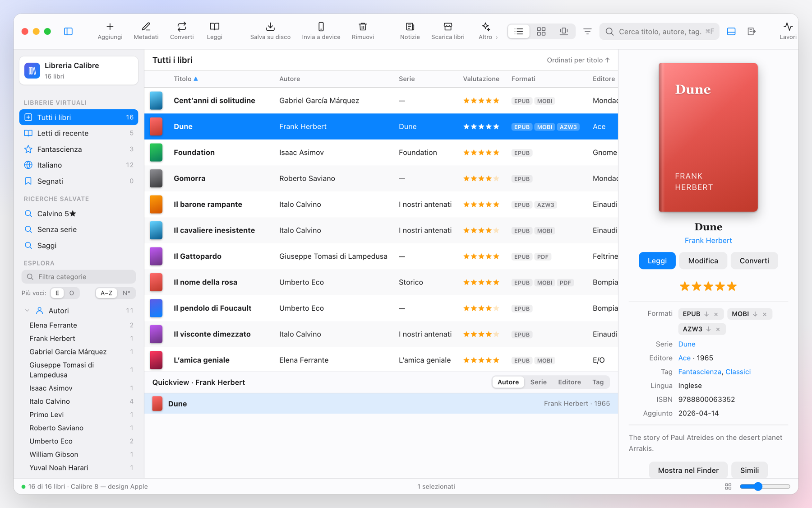
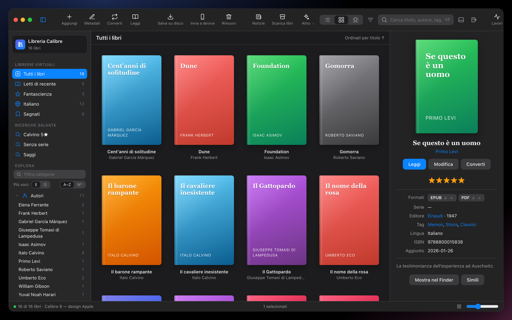
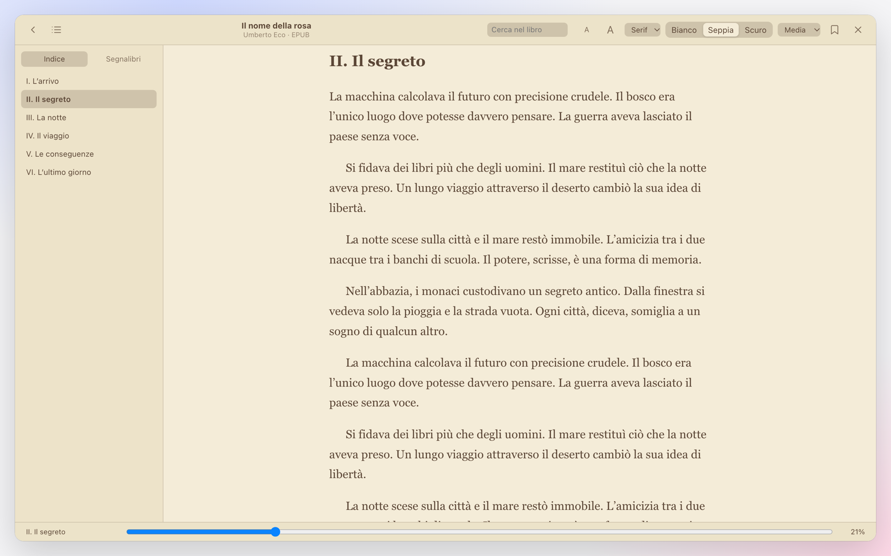
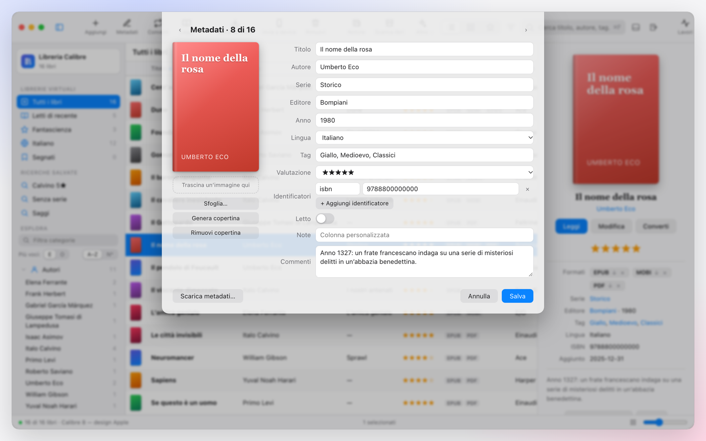
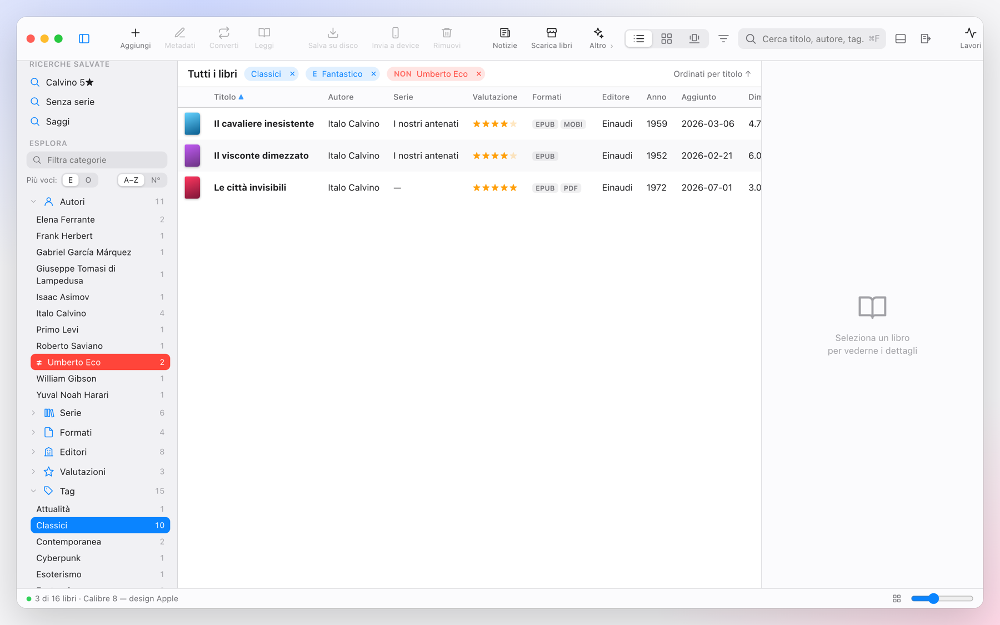
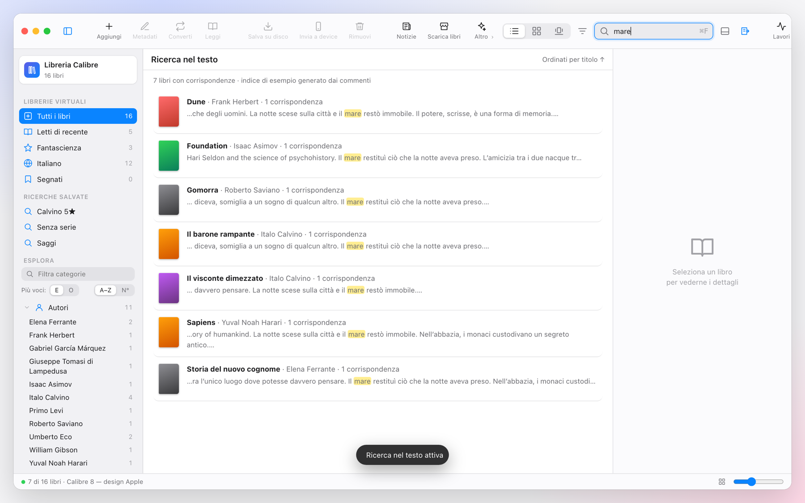

<div align="center">


# Calibre Mac

**La tua libreria Calibre, finalmente con un'interfaccia da Mac.**

SwiftUI nativo · Liquid Glass · tema chiaro/scuro di sistema · stesso motore di Calibre




<sub>Design di riferimento (prototipo HTML interattivo in <code>prototype/</code>). L'app SwiftUI ne segue il layout; gli screenshot dell'app vera arriveranno.</sub>

</div>

---

## In breve

Calibre è il miglior gestore di e-book che esista, ma la sua interfaccia è Qt: pesante su Mac e poco "mac". **Calibre Mac cambia solo l'interfaccia.** Conversione, metadati, database e ricerca restano quelli di Calibre, usati come motore in background. La GUI Qt non viene mai avviata.

- 🪟 **Nativa**: sidebar, toolbar unificata, Liquid Glass, Quick Look, Condividi, menu e scorciatoie standard.
- 🌗 **Chiaro e scuro** secondo il sistema, anche nel lettore.
- 📚 **La tua libreria esistente**, senza importare niente: si apre la cartella di Calibre.
- 🔌 **Invio all'e-reader** con un clic: Kindle, Kobo e volumi rimovibili, con conversione automatica.
- 🪶 **Leggera**: DMG da circa 2 MB, universale Apple Silicon + Intel.

## Galleria

<table>
<tr>
<td width="50%"><br><sub><b>Griglia copertine</b>, tema scuro</sub></td>
<td width="50%"><br><sub><b>Lettore</b> con indice, segnalibri, temi</sub></td>
</tr>
<tr>
<td><br><sub><b>Metadati</b>: copertina, identificatori, scarica da fonti online</sub></td>
<td><br><sub><b>Tag browser</b>: selezione multipla E/O e esclusione NON</sub></td>
</tr>
<tr>
<td colspan="2"><br><sub><b>Ricerca nel testo completo</b> dei libri, con estratti evidenziati</sub></td>
</tr>
</table>

## Cosa sa fare

<details open>
<summary><b>Libreria</b></summary>

- Elenco con **colonne personalizzabili** (clic destro sull'intestazione) e ordinamento, oppure **griglia di copertine** con zoom.
- **Ricerca** con operatori (`autore:`, `tag:`, `serie:`, `formato:`, `rating:`, `lingua:`…), ricerche salvate e **ricerca nel testo completo** (indice FTS di Calibre).
- **Tag browser**: autori, serie, tag, editori, formati, valutazioni, lingue. Selezione multipla *tutte / almeno una*, esclusione **NON**, filtro, **rinomina / unisci / rimuovi** una voce su tutti i libri.
- **Quick Look** con la barra spaziatrice, **segna** i libri, **libro a caso**.
</details>

<details open>
<summary><b>Libri e metadati</b></summary>

- Aggiungi da file, cartelle o **trascinamento**; libro vuoto; rimuovi; **salva su disco**; **Condividi** col menu di sistema.
- **Modifica metadati** singola o in blocco, con navigazione precedente / successivo.
- **Cambia copertina** da file o trascinando l'immagine sul pannello dei dettagli.
- **Scarica metadati** da fonti online e applicali, **incorpora** i metadati nei file.
- **Valutazione a stelle** direttamente da elenco e dettagli.
</details>

<details open>
<summary><b>Formati e lettura</b></summary>

- **Conversione** tra formati (EPUB, MOBI, AZW3, KEPUB, PDF, DOCX, FB2, TXT, HTMLZ) con profilo dispositivo e **rifinitura** opzionale; avanzamento nei Lavori.
- **Lettore integrato**: indice (anche per i "Capitolo N" dei TXT), segnalibri, cerca nel libro, carattere, dimensione, tema **automatico / bianco / seppia / scuro**, posizione ricordata. I PDF si aprono con PDFKit.
- **Scarica notizie** con le ricette integrate di Calibre.
</details>

<details open>
<summary><b>Invio all'e-reader</b></summary>

Collega il lettore via USB, seleziona i libri e usa **Invia a e-reader…** (`⇧⌘D`, pulsante in toolbar o menu contestuale).

| Dispositivo | Come lo riconosce | Cartella | Formati preferiti |
|---|---|---|---|
| **Kindle** | volume "Kindle", oppure cartelle `documents` + `system` | `documents/` | AZW3, MOBI, PDF, TXT |
| **Kobo** | cartella `.kobo` nella radice | radice | KEPUB, EPUB, PDF |
| **Altri e-reader USB** | volume rimovibile | `Books/` se esiste, sennò radice | EPUB, PDF, MOBI, AZW3 |

Se il libro non ha un formato compatibile viene **convertito al volo** (AZW3 per Kindle, EPUB per gli altri, con il profilo giusto). Puoi cambiare la cartella e scegliere se **espellere** il volume al termine.
</details>

## Come funziona

```
┌─────────────────────────┐   letture: HTTP /ajax    ┌──────────────────────┐
│  Calibre Mac (SwiftUI)  │ ───────────────────────▶ │   calibre-server     │
│                         │                          │   processo figlio,   │
│  sidebar · elenco ·     │   scritture: calibredb   │   solo localhost     │
│  griglia · lettore      │ ───────────────────────▶ └──────────┬───────────┘
│                         │                                     │
│                         │   ebook-convert · ebook-polish      ▼
│                         │ ───────────────────────▶   libreria Calibre
└─────────────────────────┘                             (metadata.db)
```

- **Si legge dal server, si scrive con `calibredb`** collegato al server: l'app non apre mai il database direttamente.
- Il server parte su una **porta locale libera**, ascolta solo su `127.0.0.1` e **si chiude con l'app**, anche dopo un crash. All'avvio elimina eventuali server rimasti da esecuzioni precedenti.
- Serve **Calibre installato**: viene usato solo come motore.

## Provala

**Requisiti:** macOS 26 o successivo (Apple Silicon o Intel) e [Calibre](https://calibre-ebook.com/download_osx) in `/Applications`.

```bash
cd calibre-mac
./make-dmg.sh              # build universale + installer in build/Calibre Mac.dmg
```

1. Apri il DMG e trascina **Calibre Mac** in Applicazioni.
2. Al primo avvio clic destro ▸ **Apri** (l'app non è ancora notarizzata).
3. Scegli la cartella della tua libreria con *File ▸ Apri libreria…* (`⇧⌘O`).

> ⚠️ **Non usare Calibre Mac e il Calibre originale sulla stessa libreria nello stesso momento.** Calibre lo sconsiglia per evitare conflitti sul database: chiudi uno dei due.

Per provare senza toccare la tua libreria:

```bash
python3 dev/seed.py        # crea dev/TestLibrary con 13 libri di prova
open -n --env CALIBREMAC_LIBRARY="$PWD/dev/TestLibrary" "build/Calibre Mac.app"
```

Basta lo strumento da riga di comando di Apple (**Xcode Command Line Tools**): non serve Xcode.

<details>
<summary><b>Scorciatoie da tastiera</b></summary>

| Azione | Tasti |
|---|---|
| Aggiungi libri · Apri libreria | `⌘O` · `⇧⌘O` |
| Modifica metadati · Converti | `⌘E` · `⇧⌘K` |
| Leggi · Anteprima | `⌘↩` · `spazio` / `⌘Y` |
| Invia a e-reader | `⇧⌘D` |
| Segna · Mostra nel Finder · Libro a caso | `⌘M` · `⇧⌘R` · `⌥⌘R` |
| Rimuovi | `⌘⌫` |
| Elenco · Griglia · Dettagli | `⌘1` · `⌘2` · `⌥⌘I` |
</details>

## Roadmap

- [x] Libreria, ricerca, tag browser, metadati, conversione, lettore, invio all'e-reader
- [ ] **Colonne personalizzate** di Calibre: tabella, sidebar, ricerca `#colonna:` e modifica per tipo
- [ ] **Librerie virtuali** vere e cambio libreria rapido
- [ ] **Duplicati**, controllo e ripristino libreria, cestino
- [ ] Invio via **email** (Kindle), **MTP** e wireless
- [ ] Editor del libro, modifica indice, catalogo, plugin, server contenuti, lettura vocale
- [ ] **Firma e notarizzazione** del DMG

## Domande frequenti

<details>
<summary><b>Modifica o sposta i miei libri?</b></summary>
Solo quando glielo chiedi (metadati, conversione, rimozione…), e sempre tramite gli strumenti di Calibre. Non importa né duplica la libreria. Prima di provarla su una libreria importante fai una copia di <code>metadata.db</code>.
</details>

<details>
<summary><b>Posso usarla insieme al Calibre normale?</b></summary>
Sì, ma non nello stesso momento sulla stessa libreria. Le librerie sono compatibili al 100%: sono le stesse cartelle.
</details>

<details>
<summary><b>Perché non Qt?</b></summary>
Qt è la parte pesante e meno nativa. Qui la GUI è SwiftUI, e Calibre fa solo ciò che sa fare meglio (formati, conversione, metadati).
</details>

<details>
<summary><b>Cosa non c'è ancora?</b></summary>
Vedi la <a href="#roadmap">roadmap</a>. Le priorità sono le colonne personalizzate, le librerie virtuali e il controllo della libreria.
</details>

## Cosa è stato verificato

| | |
|---|---|
| ✅ | Compila senza errori, universale arm64 + x86_64 |
| ✅ | Avvio del server, lettura di una libreria reale, ripristino dopo un crash |
| ✅ | Rilevamento di Kindle, Kobo e volume generico (volumi simulati), piano di invio e conversione TXT → AZW3 su volume |
| ✅ | Cambio copertina, identificatori e metadati tramite `calibredb` |
| ⚠️ | Invio su **un e-reader fisico** non ancora provato |
| ⚠️ | Nessun **test automatico** dell'interfaccia |
| ⚠️ | "Scarica metadati" e "Scarica notizie" richiedono internet e dipendono dalle fonti di Calibre |

## Struttura

```
calibre-mac/
├── Sources/CalibreMac/
│   ├── App.swift · ContentView.swift · SidebarView.swift
│   ├── BookViews.swift · InspectorView.swift · Sheets.swift · ReaderView.swift
│   ├── Engine.swift       server, strumenti, API
│   ├── Store.swift        stato, filtri, azioni, lavori
│   ├── Models.swift       Book, categorie, parser delle query
│   ├── DeviceScan.swift   rilevamento e-reader (logica pura)
│   └── Devices.swift      monitor dei volumi e foglio di invio
├── prototype/index.html   prototipo HTML del design
├── docs/                  immagini del README
├── tools/make_icon.swift  generatore dell'icona
├── dev/seed.py            libreria di prova
└── build.sh · make-dmg.sh
```

## Licenza e crediti

[Calibre](https://calibre-ebook.com) è di Kovid Goyal e dei collaboratori, licenza GPLv3. Questo progetto non include il codice di Calibre: lo usa come programma esterno, e segue la stessa licenza GPLv3 del repository. Non è un prodotto ufficiale e non è affiliato a Calibre.
