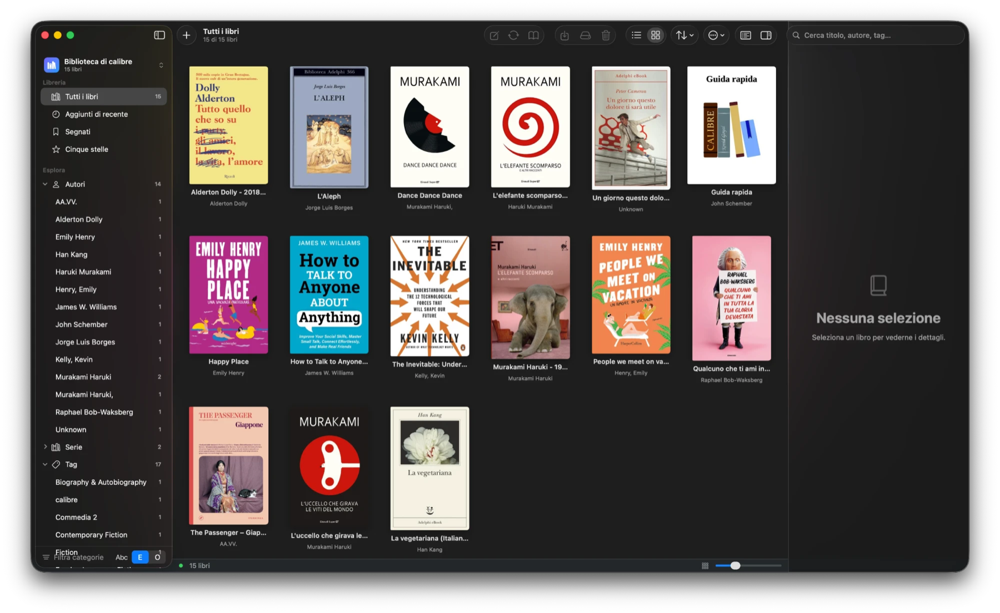

<div align="center">


# Calibre Mac

**Your Calibre library, finally with a Mac interface.**

Native SwiftUI · Liquid Glass · system light/dark theme · the same engine as Calibre




<sub>Screenshot of the real app: cover grid, dark theme, sidebar with tag browser.</sub>

</div>

---

## Overview

Calibre is the best e-book manager out there, but its interface is built with Qt: heavy on a Mac and not very "Mac". **Calibre Mac only replaces the interface.** Conversion, metadata, database and search stay exactly as Calibre does them, with Calibre running in the background as the engine. Calibre's Qt GUI is never launched.

- 🪟 **Native**: sidebar, unified toolbar, Liquid Glass, Quick Look, Share sheet, standard menus and shortcuts.
- 🌗 **Light and dark** following the system, including the reader.
- 📚 **Your existing library**, no import step: just open your Calibre folder.
- 🔌 **One-click send to e-reader**: Kindle, Kobo and removable volumes, with automatic conversion.
- 🪶 **Lightweight**: about a 2 MB DMG, universal Apple Silicon + Intel.

> **Note:** the app interface is currently in **Italian**. Localization (English first) is on the [roadmap](#roadmap).

## Features

<details open>
<summary><b>Library</b></summary>

- List view with **customizable columns** (right-click the header) and sorting, or a **cover grid** with zoom.
- **Search** with operators (`autore:`, `tag:`, `serie:`, `formato:`, `rating:`, `lingua:`…), saved searches and **full-text search** inside books (Calibre's FTS index).
- **Tag browser**: authors, series, tags, publishers, formats, ratings, languages. Multi-select with *all / any*, **NOT** exclusion, filtering, and **rename / merge / remove** a value across all books.
- **Quick Look** with the space bar, **mark** books, **random book**.
</details>

<details open>
<summary><b>Books and metadata</b></summary>

- Add from files, folders or **drag and drop**; empty book; remove; **save to disk**; **Share** through the system menu.
- **Edit metadata** for one or many books, with previous / next navigation.
- **Change the cover** from a file or by dropping an image on the details pane.
- **Download metadata** from online sources and apply it; **embed** metadata into the files.
- **Star ratings** directly from the list and the details pane.
</details>

<details open>
<summary><b>Formats and reading</b></summary>

- **Conversion** between formats (EPUB, MOBI, AZW3, KEPUB, PDF, DOCX, FB2, TXT, HTMLZ) with device profile and optional **polish**; progress is shown in Jobs.
- **Built-in reader**: table of contents (including "Capitolo N" headings in plain text books), bookmarks, in-book search, font, size, **automatic / white / sepia / dark** theme, remembered position. PDFs open with PDFKit.
- **Fetch news** using Calibre's built-in recipes.
</details>

<details open>
<summary><b>Send to e-reader</b></summary>

Plug the reader in over USB, select the books and use **Invia a e-reader…** (`⇧⌘D`, toolbar button or context menu).

| Device | How it is detected | Folder | Preferred formats |
|---|---|---|---|
| **Kindle** | volume named "Kindle", or `documents` + `system` folders | `documents/` | AZW3, MOBI, PDF, TXT |
| **Kobo** | `.kobo` folder at the volume root | volume root | KEPUB, EPUB, PDF |
| **Other USB e-readers** | removable volume | `Books/` if present, otherwise the root | EPUB, PDF, MOBI, AZW3 |

If a book has no compatible format it is **converted on the fly** (AZW3 for Kindle, EPUB for the others, with the right profile). You can change the destination folder and choose whether to **eject** the volume when done.
</details>

## How it works

```
┌─────────────────────────┐   reads: HTTP /ajax      ┌──────────────────────┐
│  Calibre Mac (SwiftUI)  │ ───────────────────────▶ │   calibre-server     │
│                         │                          │   child process,     │
│  sidebar · list ·       │   writes: calibredb      │   localhost only     │
│  grid · reader          │ ───────────────────────▶ └──────────┬───────────┘
│                         │                                     │
│                         │   ebook-convert · ebook-polish      ▼
│                         │ ───────────────────────▶   Calibre library
└─────────────────────────┘                             (metadata.db)
```

- **Reads go through the server, writes through `calibredb`** connected to that server: the app never opens the database directly.
- The server starts on a **free local port**, listens only on `127.0.0.1`, and **quits with the app**, even after a crash. At launch it also removes any server left over from a previous run.
- **Calibre must be installed**: it is used only as the engine.

## Try it

**Requirements:** macOS 26 or later (Apple Silicon or Intel) and [Calibre](https://calibre-ebook.com/download_osx) in `/Applications`.

```bash
cd calibre-mac
./make-dmg.sh              # universal build + installer at build/Calibre Mac.dmg
```

1. Open the DMG and drag **Calibre Mac** into Applications.
2. On first launch, right-click ▸ **Open** (the app is not notarized yet).
3. Pick your library folder with *File ▸ Apri libreria…* (`⇧⌘O`).

> ⚠️ **Do not use Calibre Mac and the original Calibre on the same library at the same time.** Calibre advises against it to avoid database conflicts: close one of the two.

To try it without touching your own library:

```bash
python3 dev/seed.py        # creates dev/TestLibrary with 13 sample books
open -n --env CALIBREMAC_LIBRARY="$PWD/dev/TestLibrary" "build/Calibre Mac.app"
```

You only need Apple's command line tools (**Xcode Command Line Tools**): full Xcode is not required.

<details>
<summary><b>Keyboard shortcuts</b></summary>

| Action | Keys |
|---|---|
| Add books · Open library | `⌘O` · `⇧⌘O` |
| Edit metadata · Convert | `⌘E` · `⇧⌘K` |
| Read · Quick Look | `⌘↩` · `space` / `⌘Y` |
| Send to e-reader | `⇧⌘D` |
| Mark · Reveal in Finder · Random book | `⌘M` · `⇧⌘R` · `⌥⌘R` |
| Remove | `⌘⌫` |
| List · Grid · Details | `⌘1` · `⌘2` · `⌥⌘I` |
</details>

## Roadmap

- [x] Library, search, tag browser, metadata, conversion, reader, send to e-reader
- [ ] **Custom columns** from Calibre: table, sidebar, `#column:` search and per-type editing
- [ ] Real **virtual libraries** and quick library switching
- [ ] **Duplicates**, library check and restore, trash
- [ ] Send by **email** (Kindle), **MTP** and wireless
- [ ] Book editor, ToC editor, catalog, plugins, content server, text to speech
- [ ] **English localization** of the interface
- [ ] **Code signing and notarization** of the DMG

## FAQ

<details>
<summary><b>Does it modify or move my books?</b></summary>
Only when you ask it to (metadata, conversion, removal…), and always through Calibre's own tools. It does not import or duplicate the library. Before trying it on an important library, make a copy of <code>metadata.db</code>.
</details>

<details>
<summary><b>Can I use it alongside regular Calibre?</b></summary>
Yes, but not on the same library at the same time. Libraries are 100% compatible: they are the same folders.
</details>

<details>
<summary><b>Why not Qt?</b></summary>
Qt is the heavy, less native part. Here the interface is SwiftUI, and Calibre only does what it does best (formats, conversion, metadata).
</details>

<details>
<summary><b>What is still missing?</b></summary>
See the <a href="#roadmap">roadmap</a>. Priorities are custom columns, virtual libraries and the library check.
</details>

## What has been verified

| | |
|---|---|
| ✅ | Builds without errors, universal arm64 + x86_64 |
| ✅ | Server startup, reading a real library, recovery after a crash |
| ✅ | Detection of Kindle, Kobo and a generic volume (simulated volumes), send plan, and TXT → AZW3 conversion onto a volume |
| ✅ | Cover change, identifiers and metadata through `calibredb` |
| ⚠️ | Sending to a **physical e-reader** has not been tried yet |
| ⚠️ | No **automated UI tests** |
| ⚠️ | "Download metadata" and "Fetch news" need internet and depend on Calibre's sources |

## Project layout

```
calibre-mac/
├── Sources/CalibreMac/
│   ├── App.swift · ContentView.swift · SidebarView.swift
│   ├── BookViews.swift · InspectorView.swift · Sheets.swift · ReaderView.swift
│   ├── Engine.swift       server, tools, API
│   ├── Store.swift        state, filters, actions, jobs
│   ├── Models.swift       Book, categories, query parser
│   ├── DeviceScan.swift   e-reader detection (pure logic)
│   └── Devices.swift      volume monitor and send sheet
├── prototype/index.html   interactive HTML design prototype (reference only, not the app)
├── docs/                  README images
├── tools/make_icon.swift  icon generator
├── dev/seed.py            sample library
└── build.sh · make-dmg.sh
```

## License and credits

[Calibre](https://calibre-ebook.com) is by Kovid Goyal and contributors, licensed under GPLv3. This project does not include Calibre's code: it runs Calibre as an external program, and follows the same GPLv3 license as the repository. It is not an official product and is not affiliated with Calibre.
